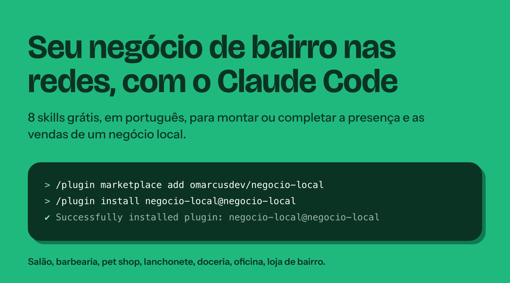
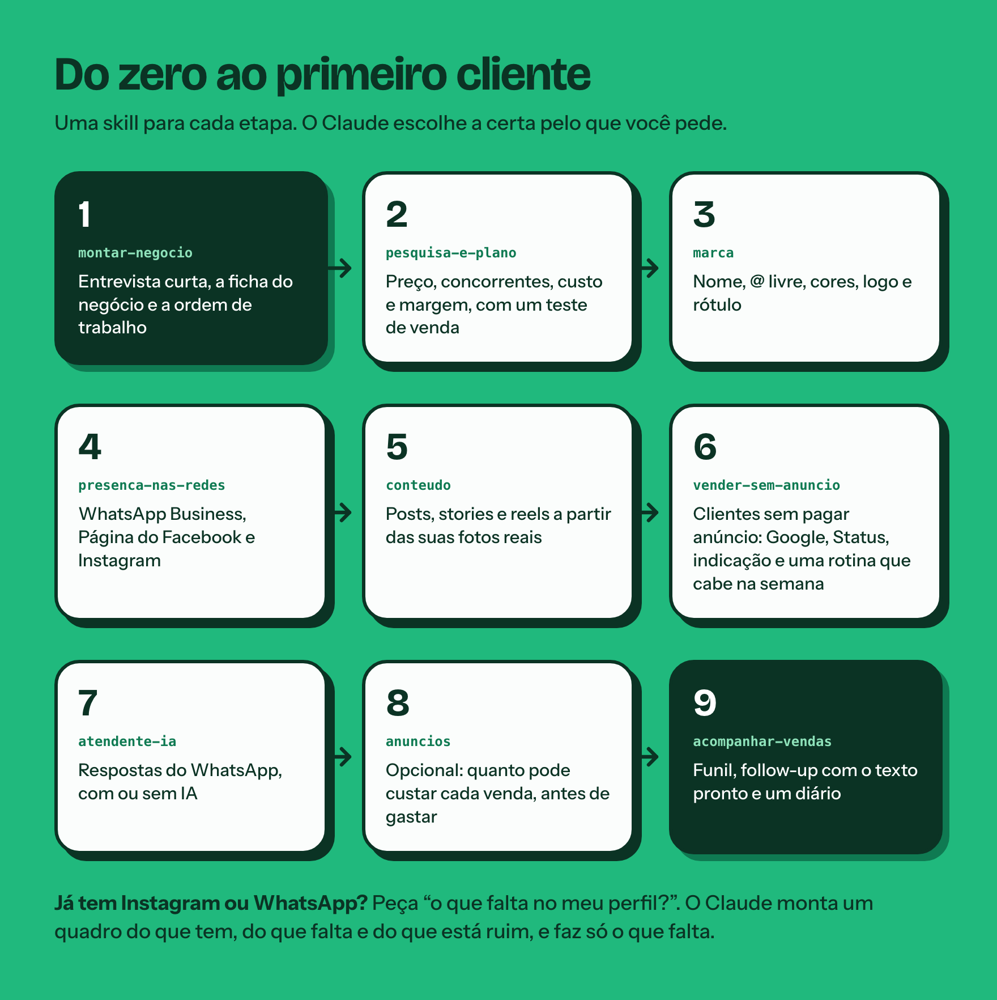
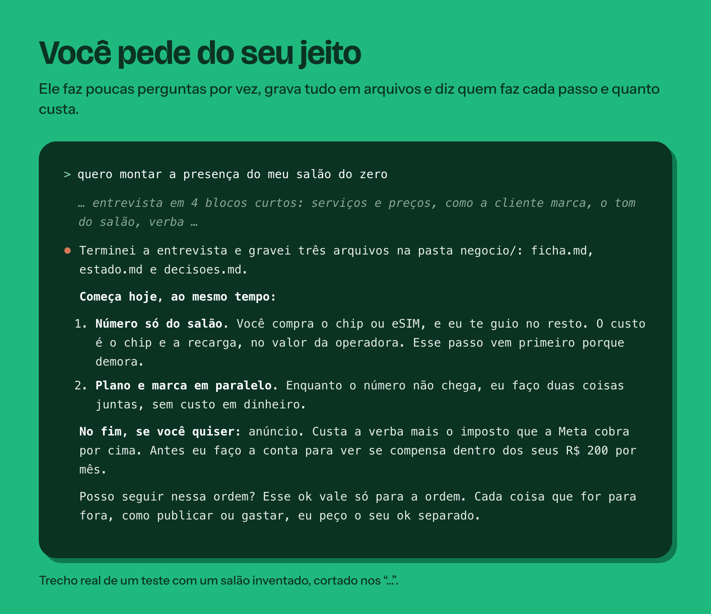
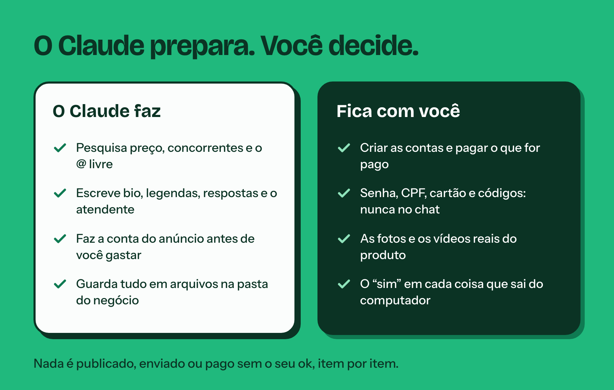
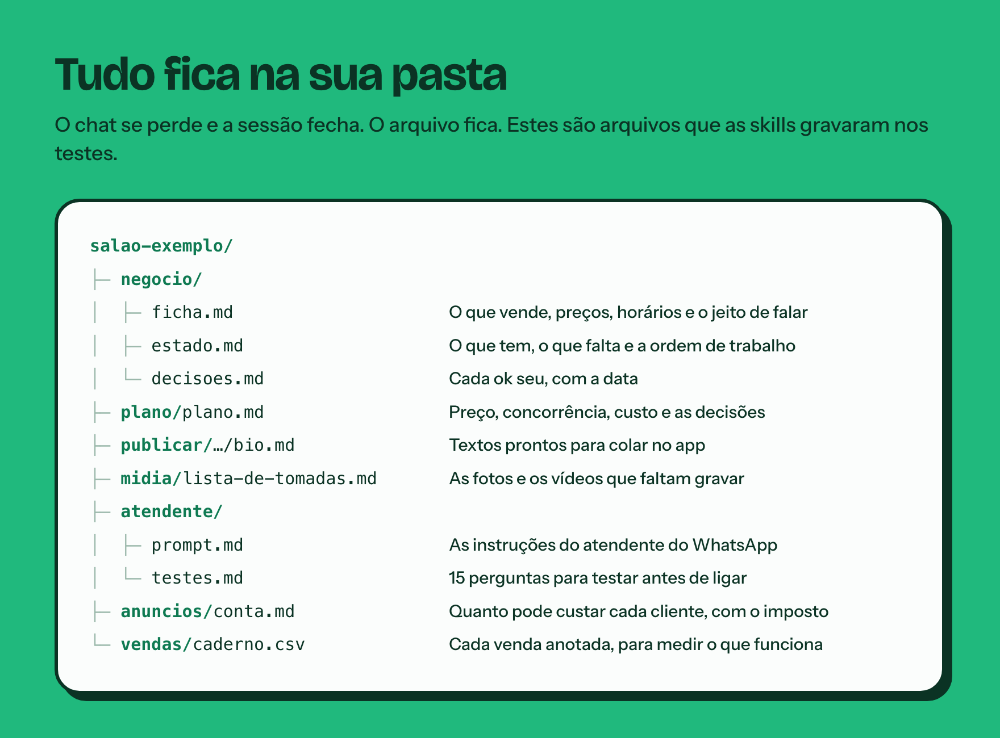

<p align="center"></p>

# skills-primeira-venda

Skills grátis para o [Claude Code](https://code.claude.com/docs/pt/overview) montar, ou completar, a presença e as vendas de um negócio local: salão, barbearia, pet shop, lanchonete, doceria, oficina, loja de bairro. Servem para o dono e para quem atende negócio local, como freelancer e agência.

Elas saíram de um caso real: um pequeno negócio de comida feita em casa que começou do zero e fez a primeira venda com a ajuda do Claude Code. O que funcionou, e o que deu errado no caminho, virou passo a passo.

> **Nunca mexeu com isso?** Siga o [passo a passo para iniciantes](https://omarcusdev.github.io/skills-primeira-venda/): Claude (pago ou grátis), Claude Code, ChatGPT e Codex.

## Instalar

Você precisa do Claude Code instalado ([guia oficial](https://code.claude.com/docs/pt/quickstart)). Depois, dentro dele, rode:

```
/plugin marketplace add omarcusdev/skills-primeira-venda
/plugin install skills-primeira-venda@omarcusdev
```

Abra o Claude Code numa pasta só do negócio e peça do seu jeito, como pediria a alguém no WhatsApp:

- "quero montar a presença do meu salão do zero"
- "vê o que já tem do meu pet shop e me diz o que falta"
- "quanto posso pagar por cliente num anúncio da minha lanchonete?"
- "escreve as respostas do WhatsApp da minha barbearia"
- "quero vender sem pagar anúncio"

### No Codex

As mesmas skills funcionam no [Codex](https://developers.openai.com/codex/cli), da OpenAI. No terminal:

```
codex plugin marketplace add omarcusdev/skills-primeira-venda
codex plugin add skills-primeira-venda@omarcusdev
```

## Como funciona

<p align="center"></p>

<p align="center"></p>

<p align="center"></p>

<p align="center"></p>

## As 9 skills

| Skill | Peça assim |
|---|---|
| `montar-negocio` | "monta meu negócio nas redes", "por onde eu começo?", "o que falta?" |
| `pesquisa-e-plano` | "quanto cobrar?", "quem são meus concorrentes?", "vale a pena?" |
| `marca` | "cria um nome", "faz um logo", "quero um rótulo pros potes" |
| `presenca-nas-redes` | "arruma meu Instagram", "configura o WhatsApp Business", "cria a Página" |
| `conteudo` | "faz um post com essas fotos", "legenda pro reel", "calendário do mês" |
| `atendente-ia` | "escreve as respostas do WhatsApp", "quero uma IA atendendo" |
| `vender-sem-anuncio` | "quero vender sem pagar anúncio", "como aparecer no Google?", "crescer no Instagram de graça" |
| `anuncios` | "quero anunciar", "quanto posso pagar por cliente?", "o anúncio deu certo?" |
| `acompanhar-vendas` | "como foram as vendas da semana?", "quem eu chamo de volta hoje?" |

Também dá para chamar pelo nome, como `/skills-primeira-venda:montar-negocio`.

## Quanto custa

- **O plugin:** grátis, licença MIT.
- **Vender sem anúncio:** grátis. Perfil no Google, Status do WhatsApp e quem já comprou vêm antes de qualquer anúncio.
- **Anúncio:** só se você quiser. O Claude faz a conta de quanto pode custar cada cliente antes de você gastar, já com o imposto do cartão.
- **IA respondendo no WhatsApp:** opcional. Sem ela, você recebe as respostas prontas para usar no WhatsApp Business, de graça.
- **Sua cota do Claude:** a pesquisa completa gasta mais. A skill oferece uma versão leve e avisa antes.

## Quem fez

<p align="center"><a href="https://instagram.com/omarcusdev"></a></p>

Mostro no Instagram, em vídeos curtos, como uso o Claude Code num negócio de verdade. [Me segue no @omarcusdev](https://instagram.com/omarcusdev) para ver os próximos passos.

## Mais detalhes

- [README do plugin](plugins/skills-primeira-venda/README.md): o que cada skill faz e não faz, ferramentas opcionais e todos os custos.
- [testes](testes/README.md): o ambiente limpo e os 19 cenários usados para conferir as skills antes de cada versão.
- Licença MIT, em [LICENSE](LICENSE).
